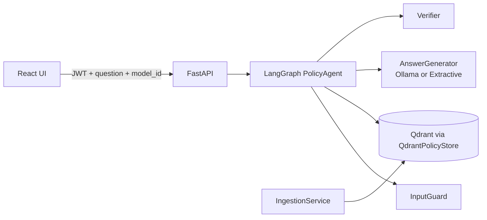

# Implementation Guide (Phase 1)

This document describes how the Policy & HR Copilot is built today: architecture, modules, request flow,
APIs, configuration, extension points, testing, and known limitations. For *what* the system must do, see
[requirements-analysis.md](requirements-analysis.md).

Contents
1. [Overview](#1-overview)
2. [Repository layout](#2-repository-layout)
3. [Architecture and design principles](#3-architecture-and-design-principles)
4. [Backend modules](#4-backend-modules)
5. [Request flow: the agent graph](#5-request-flow-the-agent-graph)
6. [Hallucination prevention](#6-hallucination-prevention)
7. [Guardrails and access control](#7-guardrails-and-access-control)
8. [Model selection](#8-model-selection)
9. [Data model and Qdrant storage](#9-data-model-and-qdrant-storage)
10. [HTTP API reference](#10-http-api-reference)
11. [Configuration reference](#11-configuration-reference)
12. [Frontend](#12-frontend)
13. [Extending the system](#13-extending-the-system)
14. [Testing](#14-testing)
15. [Running and operating](#15-running-and-operating)
16. [Known limitations and roadmap](#16-known-limitations-and-roadmap)
17. [Requirements traceability](#17-requirements-traceability)

---

## 1. Overview

A user signs in, asks a policy question, and receives an answer that cites approved company documents.
Behind the chat box a LangGraph workflow screens the question, retrieves role-permitted chunks from Qdrant,
asks the selected model for a cited answer, verifies the answer against the sources, and either returns it
or abstains.

Stack

| Layer | Technology |
|---|---|
| API | Python, FastAPI, Pydantic |
| Orchestration | LangGraph (`StateGraph`) |
| Retrieval | LangChain `langchain-qdrant`, Qdrant (embedded local mode or server) |
| Embeddings | FastEmbed, ONNX, `BAAI/bge-small-en-v1.5` (open source, local) |
| LLMs | Ollama via `langchain-ollama` (Llama 3.1, Qwen 2.5, Mistral) or an offline extractive mode |
| Frontend | React 18, Vite |
| Auth | JWT (PyJWT), demo users |



## 2. Repository layout

```
ai-application/
├── backend/
│   ├── app/
│   │   ├── api/main.py          FastAPI app, routes, startup (sample ingestion)
│   │   ├── agents/
│   │   │   ├── graph.py         PolicyAgent: LangGraph workflow
│   │   │   └── components.py    RegexInputGuard, CitationVerifier
│   │   ├── providers/
│   │   │   └── generators.py    AnswerGenerator impls, GENERATORS registry, ModelCatalog
│   │   ├── rag/
│   │   │   ├── chunking.py      Heading-aware chunker
│   │   │   ├── embeddings.py    Embeddings impls + EMBEDDINGS registry
│   │   │   ├── parsers.py       DocumentParser impls + ParserRegistry
│   │   │   ├── store.py         QdrantPolicyStore (VectorStore + VectorIndex impl)
│   │   │   ├── pipeline.py      IngestionPipeline: 7 observable stages emitting events
│   │   │   ├── ingest.py        IngestionService (blocking use, directory loading)
│   │   │   └── text.py          Front-matter parsing, text cleaning
│   │   ├── auth.py              Demo users, JWT, role dependencies
│   │   ├── config.py            Settings, ModelSpec, default model list
│   │   ├── container.py         Composition root (dependency wiring)
│   │   ├── domain.py            Framework-free dataclasses
│   │   ├── interfaces.py        Protocols (contracts)
│   │   └── registry.py          Generic named-factory Registry
│   ├── data/sample_docs/        Markdown policies with front matter
│   ├── tests/                   pytest unit and API tests
│   ├── requirements.txt
│   └── .env.example
├── frontend/src/                App.jsx, api.js, components/{Login,Message}.jsx, styles.css
├── docs/                        This guide and the requirements analysis
└── docker-compose.yml           Qdrant server and Ollama (optional)
```

## 3. Architecture and design principles

The code follows SOLID. Each principle maps to concrete files:

| Principle | How it is applied |
|---|---|
| **S**ingle responsibility | One concern per module: parsing (`parsers.py`), chunking (`chunking.py`), storage (`store.py`), ingestion orchestration (`ingest.py`), generation (`generators.py`), verification and guarding (`components.py`), workflow (`graph.py`), HTTP (`api/main.py`). |
| **O**pen/closed | `Registry` (`registry.py`) and `ParserRegistry` let you add an LLM provider, embedding provider or file type by registering a class. No existing code changes. |
| **L**iskov substitution | `LangChainGenerator` and `ExtractiveGenerator` both satisfy `AnswerGenerator`; the agent cannot tell them apart. Both return either a cited answer or the sentinel `INSUFFICIENT_CONTEXT`. |
| **I**nterface segregation | `interfaces.py` has five narrow Protocols (`DocumentParser`, `VectorStore`, `AnswerGenerator`, `Verifier`, `InputGuard`). Consumers depend only on the methods they use. |
| **D**ependency inversion | `PolicyAgent` and `IngestionService` receive abstractions through their constructors. Only `container.py` imports concrete classes and wires them. |

Layering rule: `domain.py` and `interfaces.py` import nothing from the rest of the app. `api` depends on
`container`; `container` depends on everything; nothing depends on `api`.

## 4. Backend modules

### 4.1 `domain.py`
Plain frozen dataclasses shared across layers: `ParsedPage(text, page)`, `Source` (a retrieved chunk with
`doc_id, title, section, page, version, text, score`), `GuardResult(allowed, reason)`,
`Verification(passed, reason, coverage)`, and `DocumentMeta` (the metadata attached to every chunk of a document).

### 4.2 `interfaces.py`
| Protocol | Methods |
|---|---|
| `DocumentParser` | `parse(data: bytes) -> list[ParsedPage]` |
| `VectorStore` | `add(docs)`, `search(query, role, k) -> list[Source]`, `delete(doc_id)`, `list_documents()` |
| `AnswerGenerator` | `generate(question, sources) -> str` |
| `Verifier` | `verify(answer, sources) -> Verification` |
| `InputGuard` | `check(text) -> GuardResult` |

### 4.3 `rag/chunking.py`
`chunk_text(text, size, overlap, page)` splits on markdown headings, keeping a breadcrumb such as
`Leave Policy > Annual Leave`. Within a section it packs paragraphs up to `size` characters, carrying `overlap`
characters into the next chunk, and hard-splits paragraphs longer than `2 × size`. Each chunk's text is
prefixed with its section path so the heading context is embedded and shown to the model.

### 4.4 `rag/embeddings.py`
LangChain `Embeddings` implementations registered under `EMBEDDINGS`:
- `fastembed`: `FastEmbedEmbeddings`, local ONNX model, uses `query_embed` for queries.
- `hash`: `HashEmbeddings`, deterministic bag-of-words hashing (384 dims). Offline fallback and test double. Not semantically meaningful.

### 4.5 `rag/parsers.py`
`TextParser` (`.md`, `.txt`) and `PdfParser` (`.pdf`, one `ParsedPage` per page with page numbers, via `pypdf`).
`ParserRegistry.for_file(filename)` selects by extension and raises `ValueError` for unsupported types.
Scanned PDFs (no text layer) yield empty pages; OCR is out of scope.

### 4.6 `rag/store.py`: `QdrantPolicyStore`
Implements `VectorStore` using `langchain_qdrant.QdrantVectorStore`.
- Creates the collection on first use (cosine distance, size from the embedder) and best-effort payload indexes on `metadata.doc_id|status|allowed_roles` (ignored by embedded mode).
- `search` applies a **mandatory server-side filter**: `status == "active"` AND `allowed_roles` contains the caller's role or `"all"`. Filtering happens inside Qdrant, so restricted chunks are never returned to the application.
- `delete(doc_id)` removes all chunks of a document by filter; `list_documents()` scrolls the collection and aggregates chunk counts per document.

### 4.7 Ingestion pipeline (`rag/pipeline.py`, `rag/ingest.py`, `rag/text.py`)

`IngestionPipeline.run(filename, data, meta)` is a **generator of events**, one per stage, so callers (the UI,
tests, the blocking service) can observe progress. Every document goes through seven stages:

| # | Stage | What happens | Details reported |
|---|---|---|---|
| 1 | `receive` | Reject empty files; pick the parser by extension (unsupported type fails here) | filename, size, SHA-256 prefix, parser class, document metadata |
| 2 | `parse` | Extract text per page; fail if nothing extractable (e.g. scanned PDF) | pages, characters, text preview |
| 3 | `clean` | Strip front matter, normalize line endings, drop control characters, trim trailing spaces, collapse blank-line runs | characters before/after, removed count, operations |
| 4 | `chunk` | Heading-aware chunking (see 4.3); builds LangChain `Document`s with metadata | chunk count, size settings, min/avg/max length, section list, first 3 chunk previews |
| 5 | `embed` | Computes all vectors with the configured embedding model | model, vector count, dimensions, first 8 values of vector 0, its L2 norm |
| 6 | `store` | Counts then **deletes existing chunks for the `doc_id`**, upserts the new points | collection, previous chunks removed, points upserted, sample point IDs, payload fields |
| 7 | `verify` | Confirms the index holds exactly the expected chunk count, then runs a **self-retrieval check**: searches with chunk 0's text and confirms the top hit is this document (skipped for non-active documents) | chunks in index, self-retrieval result and score |

Event shapes (NDJSON on the wire):
```
{"type":"plan","doc_id":"...","steps":[{"id":"receive","label":"Receive and validate"}, ...]}
{"type":"step","id":"embed","status":"running"}
{"type":"step","id":"embed","status":"done","duration_ms":35,"details":{...}}
{"type":"step","id":"parse","status":"error","duration_ms":1,"error":"..."}   then   {"type":"failed","error":"..."}
{"type":"complete","doc_id":"...","chunks":3}
```
A failing stage stops the pipeline: later stages never run. Because stage 6 deletes before it adds, **re-ingesting a
`doc_id` replaces the document**; a failure before stage 6 leaves the previously indexed version untouched.

The pipeline depends on abstractions only: `VectorIndex` (write side: `add_vectors`, `delete`, `count_chunks`,
`search`), `ParserRegistry`, and LangChain `Embeddings`. Embeddings are computed in the pipeline (stage 5) and handed
to the index as ready vectors, which is what makes vector creation visible.

`IngestionService` is a thin layer over the pipeline: `ingest_bytes` runs it to completion (raising `ValueError` on a
failed stage; used by `POST /api/documents`) and `ingest_directory` loads `.md/.txt` samples using their front matter.

Front-matter format (read by `ingest_directory`; stripped from uploaded text in stage 3):
  ```
  ---
  doc_id: leave-policy
  title: Leave Policy
  department: HR
  version: 2.1
  allowed_roles: all            # or comma list: hr,compliance,admin
  ---
  ```

### 4.8 `providers/generators.py`
- `SYSTEM_PROMPT` instructs: answer only from numbered sources, cite `[n]` after every sentence, never invent numbers/dates/names, reply exactly `INSUFFICIENT_CONTEXT` if unanswerable.
- `LangChainGenerator(chat_model)`: wraps any LangChain chat model. Sends system prompt plus `Sources: [1] (Title - Section) text ...` and the question.
- `ExtractiveGenerator`: no LLM. Scores sentences of the top 3 sources by keyword overlap with the question, returns the best two with `[n]` citations, or `INSUFFICIENT_CONTEXT` if none overlap.
- `GENERATORS` registry: `ollama` (builds `ChatOllama(model, base_url, temperature)`), `extractive`.
- `ModelCatalog`: maps `ModelSpec.id` to a generator, built **lazily and cached**; exposes `specs()` and `default_id`; `get(None)` returns the default; unknown id raises `KeyError`.

### 4.9 `agents/components.py`
- `RegexInputGuard`: blocks prompt-injection phrases (e.g. "ignore previous instructions", "reveal your system prompt") and questions over 2000 characters.
- `CitationVerifier(min_coverage)`: see [section 6](#6-hallucination-prevention).

### 4.10 `agents/graph.py`: `PolicyAgent`
Constructed with a guard, a store, a `resolve_generator` callable, a verifier and thresholds; compiles the LangGraph on construction. `run(question, role, model_id)` returns the final `AgentState`. See the next section.

### 4.11 `auth.py`
Five demo users (`alice` employee, `mark` manager, `hannah` hr, `carl` compliance, `root` admin). `create_token` issues an HS256 JWT with `sub, name, role, department, exp`. `current_user` is a FastAPI dependency that validates the bearer token; `require_roles(*roles)` builds a role-checking dependency. **Demo only**: passwords are in source and the secret defaults to a dev value.

### 4.12 `container.py`: composition root
`Container(settings)` builds the Qdrant client (server if `QDRANT_URL`, otherwise embedded at `QDRANT_PATH`), the embeddings via the registry, the store, ingestion service, model catalog and `PolicyAgent`. `get_container()` is `lru_cache`d and used as the FastAPI dependency, so tests and alternative deployments can substitute it.

### 4.13 `api/main.py`
Routes (see [section 10](#10-http-api-reference)). On startup (`lifespan`) it ingests `data/sample_docs` when the collection is empty and `AUTOLOAD_SAMPLES` is true.

## 5. Request flow: the agent graph


`AgentState` fields: `question, role, model_id, sources, answer, verification, attempts, abstained,
abstain_reason, trace`.

| Node | Behavior |
|---|---|
| `guard` | Runs `InputGuard.check`. On block sets `abstained` and the reason. |
| `retrieve` | `store.search(question, role, TOP_K)`; keeps only chunks with `score >= MIN_RETRIEVAL_SCORE`. Zero kept means abstain with "no relevant sources". |
| `generate` | Resolves the generator for `model_id` (default if none), generates an answer, increments `attempts`. |
| `verify` | Runs `Verifier.verify`. |
| `abstain` | Replaces the answer with a fixed message directing the user to HR; keeps the reason. |

Each node appends a human-readable line to `trace` (for example `retrieve: 5 found, 3 above threshold`,
`verify: fail (no citations)`). The API returns the trace and the UI shows it under "show steps".

`MAX_GENERATION_ATTEMPTS` (default 2) bounds the generate/verify loop so a misbehaving model cannot loop.

## 6. Hallucination prevention

Defenses are layered; failing any layer ends in abstention rather than a guess.

1. **Closed-book prompt.** The model sees only the retrieved sources and is told to answer from them or emit `INSUFFICIENT_CONTEXT`.
2. **Retrieval threshold.** Chunks below `MIN_RETRIEVAL_SCORE` (cosine similarity, default 0.45) are dropped. An off-topic question ("how do I bake bread?") retrieves nothing relevant and abstains before any model is called.
3. **Citation verifier** (`CitationVerifier`), applied to every non-abstaining answer:
   - at least one `[n]` citation exists;
   - every `n` is between 1 and the number of sources (no invented sources);
   - citation **coverage**, the share of sentences with a citation, is at least `MIN_CITATION_COVERAGE` (default 0.6);
   - every number in the answer (citation markers excluded) appears verbatim in the concatenated source text, which catches invented figures such as "30 days" when the policy says 24.
4. **Bounded retry**, then abstain.
5. **Transparency.** The UI shows citations, the source passage, the similarity score, the verification result and the step trace.

What this does *not* yet do: semantic claim-by-claim entailment checking (a citation may exist but not support the sentence), conflict detection between document versions, and a confidence score. These are Phase 2 items.

## 7. Guardrails and access control

| Control | Where | Behavior |
|---|---|---|
| Prompt-injection screening | `RegexInputGuard` | Regex on known jailbreak phrasing; blocked questions abstain with reason. |
| Retrieved-text handling | prompt design | Sources are inserted as data under "Sources"; the system prompt restricts the model to them. Document-side injection scanning is not yet implemented. |
| Document RBAC | `QdrantPolicyStore.search` | Role filter enforced inside Qdrant; document-level `allowed_roles`. |
| Version/status filter | `QdrantPolicyStore.search` | Only `status == "active"` chunks are retrievable. |
| Endpoint RBAC | `require_roles` | Document list/upload/delete require `admin`, `hr` or `compliance`. |
| Authentication | `current_user` | Bearer JWT on every route except `/auth/login` and `/health`. |

Roles: `employee, manager, hr, compliance, admin`. A document's `allowed_roles` of `all` means everyone.
Role hierarchy is not inferred: a document restricted to `hr` is not visible to `admin` unless `admin` is listed.

## 8. Model selection

Two levels, one source of truth (`ModelSpec`):

```python
ModelSpec(id="llama3.1-8b", label="Llama 3.1 8B (Ollama)", provider="ollama",
          name="llama3.1:8b", temperature=0.0, default=True)
```

**Config level**
- Defaults live in `config.py` (`DEFAULT_MODELS`): Llama 3.1 8B (default), Qwen 2.5 7B, Mistral 7B, and `extractive`.
- Override with `MODELS_CONFIG=/path/models.json`, a JSON array of `ModelSpec` objects. Example:
  ```json
  [
    {"id": "qwen-14b", "label": "Qwen 2.5 14B", "provider": "ollama", "name": "qwen2.5:14b", "default": true},
    {"id": "extractive", "label": "Offline", "provider": "extractive"}
  ]
  ```
- Embeddings are chosen only here (`EMBEDDING_PROVIDER`, `EMBEDDING_MODEL`) because a collection's vector size is fixed. The collection name embeds the provider and model (for example `policy_chunks__fastembed_baai_bge_small_en_v1_5`), so changing embedding models creates a **new, empty collection** that is re-populated from the sample docs on startup. Upload documents again if you ingested your own.

**Application level**
- `GET /api/models` returns the list and the default; the UI dropdown renders it.
- `POST /api/chat` accepts an optional `model_id`. Unknown id returns 400. A provider that cannot be built or reached returns 503 with a message to check Ollama.
- The chosen model id is echoed in the response and shown under each answer.

## 9. Data model and Qdrant storage

One Qdrant point per chunk. `langchain-qdrant` stores the text as `page_content` and everything else under
`metadata`:

| Field (`metadata.*`) | Type | Purpose |
|---|---|---|
| `doc_id` | keyword | Replace/delete a document |
| `title` | string | Citation label |
| `department` | string | Informational; filter-ready |
| `version` | string | Shown in citations |
| `status` | keyword | `active` is retrievable; others are not |
| `allowed_roles` | keyword list | RBAC filter |
| `section` | string | Heading breadcrumb |
| `page` | int or null | PDF page number |

Vector: dense, cosine, dimension from the embedder (384 for bge-small). Embedded mode stores data under
`backend/data/qdrant/` (git-ignored); only one process may open it at a time. Use the Qdrant server
(`QDRANT_URL`) for multiple workers.

## 10. HTTP API reference

All routes except `/auth/login` and `/health` need `Authorization: Bearer <token>`.

| Method and path | Role | Description |
|---|---|---|
| `POST /auth/login` | none | Body `{username, password}`. Returns `{access_token}`. 401 on bad credentials. |
| `GET /api/me` | any | Current user `{id, name, role, department}`. |
| `GET /api/models` | any | `{default, models: [{id, label, provider}]}`. |
| `POST /api/chat` | any | Body `{question, model_id?}`. See response below. |
| `GET /api/documents` | admin, hr, compliance | Documents with chunk counts. |
| `POST /api/documents` | admin, hr, compliance | Multipart: `file`, `title`, `doc_id`, `department`, `version`, `allowed_roles` (comma list or `all`), `status` (`active`, `inactive`, `draft`). Re-using a `doc_id` replaces the document. Returns `{doc_id, chunks}`. 400 for invalid metadata, unsupported file types or other pipeline failures. |
| `POST /api/documents/ingest` | admin, hr, compliance | Same form fields. Runs the pipeline and **streams NDJSON events** (`application/x-ndjson`), one line per stage transition (see 4.7). Metadata problems return 400 before streaming; pipeline failures arrive in-stream as a `failed` event with HTTP 200. |
| `DELETE /api/documents/{doc_id}` | admin, hr, compliance | Removes all chunks of the document. |
| `GET /health` | none | `{status: "ok"}`. |

`POST /api/chat` response:
```json
{
  "answer": "Employees receive 10 days of paid sick leave per year [1].",
  "abstained": false,
  "abstain_reason": null,
  "model_id": "extractive",
  "sources": [{"doc_id": "leave-policy", "title": "Leave Policy", "section": "Leave Policy > Sick Leave",
               "page": null, "version": "2.1", "text": "...", "score": 0.81}],
  "verification": {"passed": true, "reason": "grounded", "coverage": 1.0},
  "trace": ["guard: ok", "retrieve: 5 found, 5 above threshold", "generate: attempt 1", "verify: pass (grounded)"]
}
```
When `abstained` is true, `answer` is the fixed fallback message and `sources` is empty.

Error codes: 400 unknown model or file type, 401 missing/invalid token, 403 insufficient role, 503 model
unavailable.

Example:
```bash
TOKEN=$(curl -s -X POST localhost:8010/auth/login -H 'Content-Type: application/json' \
  -d '{"username":"alice","password":"alice123"}' | python -c "import sys,json;print(json.load(sys.stdin)['access_token'])")
curl -s -X POST localhost:8010/api/chat -H "Authorization: Bearer $TOKEN" -H 'Content-Type: application/json' \
  -d '{"question":"How many sick days do I get?","model_id":"extractive"}'
```

## 11. Configuration reference

Set as environment variables or in `backend/.env` (see `.env.example`). Names are case-insensitive.

| Variable | Default | Description |
|---|---|---|
| `MODELS_CONFIG` | none | JSON file overriding the model list |
| `OLLAMA_BASE_URL` | `http://localhost:11434` | Ollama endpoint |
| `QDRANT_URL` | none | Qdrant server URL; if unset, embedded storage is used |
| `QDRANT_PATH` | `backend/data/qdrant` | Embedded storage directory |
| `QDRANT_COLLECTION_PREFIX` | `policy_chunks` | Prefix of the collection name |
| `EMBEDDING_PROVIDER` | `fastembed` | `fastembed` or `hash` |
| `EMBEDDING_MODEL` | `BAAI/bge-small-en-v1.5` | Model for the embedding provider |
| `TOP_K` | 5 | Chunks retrieved per question |
| `MIN_RETRIEVAL_SCORE` | 0.45 | Minimum similarity to keep a chunk |
| `MIN_CITATION_COVERAGE` | 0.6 | Minimum share of cited sentences |
| `MAX_GENERATION_ATTEMPTS` | 2 | Generate/verify loop bound |
| `CHUNK_SIZE` / `CHUNK_OVERLAP` | 900 / 150 | Chunking in characters |
| `JWT_SECRET` | `dev-only-change-me` | **Change outside local development** |
| `JWT_EXPIRE_MINUTES` | 480 | Token lifetime |
| `SAMPLE_DOCS_DIR` | `backend/data/sample_docs` | Startup ingestion source |
| `AUTOLOAD_SAMPLES` | true | Ingest samples when the collection is empty |
| `CORS_ORIGINS` | `["http://localhost:5173"]` | Allowed browser origins (JSON list) |

Tuning notes: raising `MIN_RETRIEVAL_SCORE` makes the system abstain more and answer fewer borderline
questions; scores depend on the embedding model, so re-tune after changing it. The `hash` embedder produces much
lower scores, so tests set `MIN_RETRIEVAL_SCORE=0.15`.

## 12. Frontend

React + Vite, no UI framework. In dev, Vite proxies `/api` and `/auth` to `http://localhost:8010`
(`vite.config.js`).

| File | Role |
|---|---|
| `src/api.js` | `fetch` wrapper; keeps the JWT in `sessionStorage`; `login, logout, me, models, chat`. Errors carry the server `detail`. |
| `src/App.jsx` | Session bootstrap (`/api/me` and `/api/models`), model dropdown, message list, composer, sign-out. |
| `src/components/Login.jsx` | Login form with demo-user shortcuts. |
| `src/components/IngestPage.jsx` | Ingestion tab (visible to admin, hr, compliance): upload form (title and ID auto-filled from the filename, department, version, role preset or custom roles, status), runs `api.ingest`, applies each streamed event to the step list, then refreshes the document list. |
| `src/components/StepTimeline.jsx` | Renders the pipeline stages with status icons (pending, running, done, error), durations and expandable details: key/value rows, chunk preview cards, vector preview, JSON blocks. Failed stages open automatically. |
| `src/components/DocumentsTable.jsx` | Indexed documents (title, ID, version, status, roles, chunk count) with delete. |
| `src/components/Message.jsx` | Renders answers with clickable `[n]` citation chips, expandable source passages with score, verification badge, collapsible step trace, abstained styling. |
| `src/styles.css` | Light/dark theme via CSS variables and `prefers-color-scheme`. |

The token lives in `sessionStorage` (cleared when the tab closes). Chat history is held in component state only.

## 13. Extending the system

**Add an LLM provider** (for example vLLM or any OpenAI-compatible server)
1. Create the generator, reusing `LangChainGenerator` with any LangChain chat model.
2. Register it in `providers/generators.py`:
   ```python
   @GENERATORS.register("vllm")
   def _vllm(spec: ModelSpec, settings: Settings):
       from langchain_openai import ChatOpenAI
       return LangChainGenerator(ChatOpenAI(model=spec.name, base_url=settings.vllm_url, api_key="x"))
   ```
3. Add a `ModelSpec` with `provider="vllm"` to the config list. The UI picks it up automatically.

**Add an embedding provider**: implement a LangChain `Embeddings` class and `@EMBEDDINGS.register("name")`; set `EMBEDDING_PROVIDER=name`.

**Add a file type**: write a class with `parse(data) -> list[ParsedPage]` and register it in `default_parsers()`, for example `.register((".docx",), DocxParser())`.

**Swap the vector store**: implement the `VectorStore` Protocol and construct it in `container.py`. The agent and ingestion service need no change.

**Add a stronger verifier or guard**: implement `Verifier` or `InputGuard` (for example an LLM-based entailment check, or a classifier) and pass it in `container.py`. To chain several, write a small composite that implements the same Protocol.

**Add a graph node or agent**: add a method to `PolicyAgent`, register it in `_build()`, and add edges. Keep node logic over injected abstractions so it stays testable.

## 14. Testing

```bash
cd backend && .venv/Scripts/python -m pytest      # 25 tests
```

`tests/conftest.py` sets environment variables **before** importing the app: `EMBEDDING_PROVIDER=hash`,
`QDRANT_PATH` to a temp directory, and `MIN_RETRIEVAL_SCORE=0.15`. Tests therefore run offline in about a second, using the
`extractive` model.

| File | Covers |
|---|---|
| `test_units.py` | Chunk sizing and section breadcrumbs; verifier accept/reject cases (no citation, bad index, ungrounded number, abstain); injection guard; extractive citations; `Registry`; `ModelCatalog` default and caching |
| `test_api.py` | Auth required; model list; grounded cited answer; off-topic abstention; injection blocked; unknown model 400; **RBAC** (employee cannot see the HR-restricted document, HR can); document endpoints restricted by role |
| `test_pipeline.py` | Text cleaning and front matter; all seven stages emitted in order with JSON-serializable events; chunk, embedding (384 dims, 8-value preview), store and verify details; re-ingest replaces rather than duplicates; pipeline stops at the failing stage (unsupported type, empty file); inactive documents skip self-retrieval; an ingested document is found by chat; `/api/documents/ingest` returns NDJSON, reports failures in-stream, enforces RBAC and validates `doc_id`, roles and status; delete removes chunks |

Not covered by automated tests: the Ollama path (needs a running server), real-embedding relevance, the
frontend, and PDF parsing. Verified manually: the full chat flow and the ingestion flow in the browser with real
embeddings (HR user uploads a markdown file, watches the seven stages, then asks a question about it).

## 15. Running and operating

See the [README](../README.md) for setup commands. Operational notes:
- First start downloads the embedding model (needs internet once; cached afterwards) and indexes the sample documents.
- Embedded Qdrant allows one process; run `uvicorn` with a single worker or switch to the Qdrant server.
- With Ollama, run `ollama pull llama3.1:8b` (or the models you configure). Responses take seconds on CPU.
- Port 8010 is used for the API to avoid clashing with other local apps on 8000.
- Do not deploy as-is: replace the demo users and `JWT_SECRET`, restrict CORS, and add TLS.

## 16. Known limitations and roadmap

| Limitation | Planned phase |
|---|---|
| Dense-only retrieval, no reranker | Phase 2: hybrid (dense + sparse) search and reranking |
| Rule-based verifier cannot judge whether a citation truly supports a claim | Phase 2: LLM or NLI groundedness check, conflict detection across versions |
| Extractive mode can return loosely related sentences | Mitigated by an LLM plus verifier; measured by a golden-set evaluation (Phase 2) |
| Single-shot Q&A; no conversation memory or query rewriting | Phase 2 |
| One agent graph; no router, HR-operations or escalation agents | Phase 3 |
| Regex-only guardrails; no PII redaction, no document-side injection scanning | Phase 4 |
| Observability is the per-request trace only; no persistence, cost or quality metrics | Phase 5 (Langfuse or Phoenix, audit log, dashboard) |
| Demo auth, in-memory chat history, no admin UI | Phase 3 to 6 |
| No evaluation suite in CI | Phase 2 |

## 17. Requirements traceability

Status of the requirement IDs in [requirements-analysis.md](requirements-analysis.md):

| Requirement | Status | Notes |
|---|---|---|
| FR-ING-1, 2, 3, 4, 5, 6 | Done (partial for 5) | md/txt/pdf; versions stored and `status` filtered, no automatic supersede workflow |
| FR-ING-8 | Done | Step-by-step pipeline view in the Ingestion tab |
| FR-ING-7 | Not started | Document-side injection scan |
| FR-RAG-1 | Partial | Dense only |
| FR-RAG-2, 5 | Done | Role/status filters; section/page/title returned |
| FR-RAG-3, 4, 6 | Not started / partial | Thresholds configurable; no rerank or query rewriting |
| FR-HAL-1, 2, 4, 7 | Done | Closed-book prompt, citations, abstain, number check |
| FR-HAL-3 | Partial | Rule-based; no semantic entailment |
| FR-HAL-5, 6, 8 | Partial / not started | Score and version shown; no conflicts or feedback |
| FR-AGT-7, 8 | Done | Explicit graph, bounded attempts |
| FR-AGT-1 to 6, 9 | Not started | Router, HR-ops, escalation, approvals |
| FR-GRD-1, 4 | Done / partial | Regex injection check; document and endpoint RBAC |
| FR-GRD-2, 3, 5 to 8 | Not started | |
| FR-OBS-1 | Partial | Step trace per request |
| FR-OBS-2 to 8 | Not started | |
| FR-UI-1 (streaming) | Partial | Chat without streaming |
| FR-UI-2, 3, 7 | Partial | Citations and source view, step trace; no feedback button |
| FR-UI-5 | Partial | Document upload, list and delete with live ingestion steps; no version history or guardrail settings |
| FR-AUTH-1 to 3 | Partial | Demo JWT, five roles, claims drive filters |
| NFR-8, 9 | Partial | Typed, modular; tests exist; Docker Compose provides Qdrant and Ollama only |
